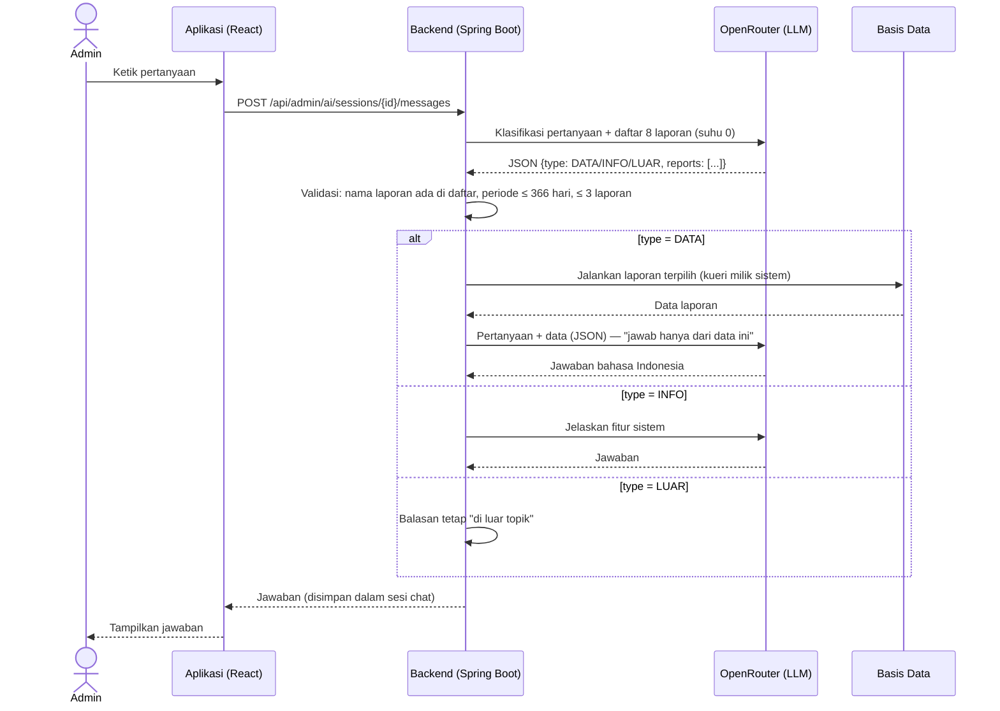

# Usulan Perubahan Judul dan Ruang Lingkup

Bahan konsultasi dengan dosen pembimbing. Semua teks di bawah adalah **draf**; sesuaikan dengan
gaya penulisan prodi sebelum dipindahkan ke berkas `.docx` proposal/skripsi.

Disusun 26 September 2026.

---

## 1. Judul

| | Judul |
|---|---|
| Proposal (lama) | Pengembangan Sistem Informasi Penjualan dan Manajemen Persediaan Berbasis Web Menggunakan Metode Waterfall pada Usaha Zelatan Cell |
| **Usulan** | Pengembangan Sistem Informasi Penjualan dan Manajemen Persediaan Berbasis Web **Terintegrasi Asisten AI** pada Usaha Zelatan Cell |

### Alasan

1. Fitur asisten AI (usulan SKPL-F20) sudah selesai dibangun dan diuji, sehingga layak menjadi
   bagian identitas penelitian, bukan sekadar fitur tambahan.
2. Objek (Zelatan Cell) dan sistem (penjualan dan manajemen persediaan berbasis web) tetap sama,
   jadi BAB I–III tidak perlu ditulis ulang, cukup ditambah.
3. Frasa "Menggunakan Metode Waterfall" dikeluarkan dari judul supaya judul lebih ringkas. Judul
   tetap memuat objek, sistem, platform, dan kebaruan (asisten AI). **Metode penelitian tetap
   Waterfall**, dan tetap ditulis di BAB I (metodologi) serta BAB III, jadi isi laporan tidak
   berubah karena hal ini.
4. Rancangan asisten AI dapat dipertanggungjawabkan secara ilmiah:
   - AI **tidak menulis kueri basis data**. Model hanya memilih laporan dari daftar tetap
     (8 laporan), lalu sistem sendiri yang menjalankan kueri.
   - Semua angka pada jawaban berasal dari data sistem, bukan karangan model.
   - Ketepatannya diukur di BAB IV (`docs/EVALUASI-ASISTEN-AI.md`).

### Yang perlu dipastikan ke pembimbing / prodi

- [ ] Apakah perubahan judul setelah seminar proposal diperbolehkan, dan bagaimana prosedurnya.
- [ ] Apakah prodi mewajibkan metode pengembangan (Waterfall) tertulis di judul. Jika wajib, pakai
      "... Terintegrasi Asisten AI Menggunakan Metode Waterfall pada Usaha Zelatan Cell".
- [ ] Persetujuan fitur di luar Tabel 3.6 (bagian 5), atau fitur mana yang tidak dimasukkan ke
      laporan (kode boleh tetap ada).
- [ ] Dua catatan BAB I yang masih terbuka (`docs/KONTEKS-SESI.md` bagian 9).

---

## 2. Draf tambahan BAB I

> Penomoran poin lama **tidak diubah**. Poin baru ditambahkan di akhir setiap daftar.

**Latar belakang** — satu paragraf tambahan setelah paragraf tentang laporan penjualan:

> Laporan penjualan yang lengkap belum tentu mudah dimanfaatkan. Untuk menjawab pertanyaan sehari-hari
> seperti "berapa omset minggu ini dibanding minggu lalu?" atau "produk apa yang stoknya hampir
> habis?", admin harus membuka beberapa halaman laporan, mengatur filter periode, lalu membandingkan
> angkanya sendiri. Perkembangan *Large Language Model* (LLM) memungkinkan sistem menerima
> pertanyaan dalam bahasa sehari-hari dan menyajikan jawabannya dalam bentuk ringkasan. Namun,
> LLM juga dikenal dapat menghasilkan informasi yang tidak sesuai fakta (*halusinasi*), sehingga
> integrasinya ke sistem informasi perlu dirancang agar setiap angka yang disajikan tetap bersumber
> dari basis data sistem.

**Rumusan masalah** — poin tambahan:

> Bagaimana mengintegrasikan asisten AI berbasis *Large Language Model* ke dalam sistem informasi
> penjualan Zelatan Cell agar admin dapat menelaah laporan penjualan dan persediaan melalui
> pertanyaan dalam bahasa sehari-hari, dengan jawaban yang bersumber dari data sistem?

**Tujuan penelitian** — poin tambahan:

> Mengintegrasikan asisten AI yang dapat menjawab pertanyaan admin tentang omset, laba, produk
> terlaris, stok menipis, top up, promo, dan rating pelanggan berdasarkan data sistem, serta
> mengukur ketepatan jawabannya.

**Manfaat penelitian** (bagi pemilik usaha) — poin tambahan:

> Admin dapat memperoleh ringkasan kondisi penjualan dan persediaan lebih cepat melalui percakapan,
> tanpa harus menyusun sendiri laporan dari beberapa halaman.

**Batasan masalah** — poin tambahan:

1. Asisten AI hanya dapat digunakan oleh admin.
2. Asisten AI menjawab pertanyaan seputar data toko melalui delapan jenis laporan yang telah
   ditentukan:
   - ringkasan penjualan;
   - penjualan harian;
   - produk terlaris;
   - penjualan per kategori dan provider;
   - stok menipis;
   - top up saldo;
   - performa voucher dan flash sale;
   - rating pelanggan.

   Asisten AI tidak membuat kueri basis data sendiri.
3. Model bahasa diakses melalui layanan OpenRouter. Penelitian ini tidak melatih model sendiri dan
   tidak mencakup peramalan (*forecasting*).
4. Asisten AI tidak menampilkan data pribadi pelanggan (password, email, nomor HP, saldo per orang).
5. Pertanyaan dan jawaban menggunakan Bahasa Indonesia; satu pertanyaan maksimal memakai tiga
   laporan dengan rentang periode maksimal 366 hari.
6. *(batasan sistem lain yang juga perlu ditulis)*
   - Pengiriman produk digital (pulsa, paket data, token listrik, voucher game) **disimulasikan**:
     nomor seri dan token dibuat oleh sistem, tanpa terhubung ke API pemasok/PPOB.
   - Pembayaran Xendit berjalan pada mode *sandbox* (tanpa transaksi uang riil).
   - Barang fisik (aksesoris) hanya dijual langsung di konter, tidak melalui aplikasi.

---

## 3. Subbab BAB II yang perlu ditambah

Cari rujukan jurnal/buku 5–10 tahun terakhir untuk setiap subbab. Jangan memakai rujukan yang belum
dibaca sendiri.

| Subbab | Isi yang dibutuhkan |
|---|---|
| Kecerdasan Buatan (*Artificial Intelligence*) | Definisi, cabang *Natural Language Processing* |
| *Large Language Model* | Cara kerja umum (model bahasa berbasis *transformer*), kelebihan, dan keterbatasannya (halusinasi) |
| Asisten virtual / asisten AI | Pengertian dan contoh penerapan pada sistem informasi bisnis |
| *Prompt* dan keluaran terstruktur | *System prompt*, keluaran JSON, suhu (*temperature*) |
| Pemilihan alat (*tool selection* / *function calling*) | Pola desain: model memilih fungsi, sistem yang mengeksekusi |
| API LLM dan OpenRouter | Layanan perantara ke banyak model; model cadangan (*fallback*) |
| Keamanan LLM | *Prompt injection*, pembatasan data sensitif, *grounding* jawaban pada data |
| Evaluasi ketepatan | Akurasi (jawaban benar / total pertanyaan) sebagai ukuran evaluasi |

---

## 4. Rancangan asisten AI (bahan BAB III)

Alur satu pertanyaan (dari `services/AiChatService.java`):

Poin yang perlu ditonjolkan di BAB III:
- **Dua tahap LLM.** Tahap 1 hanya mengklasifikasi pertanyaan dan memilih laporan (suhu 0,
  keluaran JSON). Tahap 2 menyusun kalimat jawaban dari data (suhu 0,3).
- **Whitelist laporan.** Nama laporan di luar daftar ditolak, tidak "diperbaiki" menjadi kueri.
- **Isolasi data.** Data dikirim di dalam tag `<data>` dengan instruksi bahwa isinya data, bukan
  perintah. Ini mencegah komentar pelanggan dipakai untuk *prompt injection*.
- **Tanpa data pribadi.** Tidak ada laporan yang memuat password, email, nomor HP, atau saldo per
  orang.
- **Riwayat percakapan.** 10 pesan terakhir disertakan, sehingga pertanyaan lanjutan seperti
  "kalau bulan lalu?" dipahami.

---

## 5. Perubahan BAB III

### Tabel 3.6 — usulan baris tambahan

| Kode | Kebutuhan fungsional | Status |
|---|---|---|
| SKPL-F20 | Admin dapat bertanya tentang data toko kepada asisten AI dan mengelola sesi percakapan | Baru |
| SKPL-F21 | Pelanggan dapat memberi ulasan toko (rating 1–5 dan komentar); ulasan tampil publik; admin dapat membalas | Baru |
| SKPL-F22 | Pelanggan dapat membayar produk langsung melalui Xendit (biaya admin 10%) selain memakai saldo | Baru |
| SKPL-F23 | Pelanggan mengisi nomor tujuan sesuai jenis produk (nomor HP, nomor meter PLN, ID game) dan memilih produk melalui katalog kategori → provider → nominal | Pengembangan |
| SKPL-F24 | Pelanggan dan admin dapat mencetak struk token PLN ke printer thermal | Baru |
| SKPL-F25 | Pelanggan dapat mengubah nama pengguna dan foto profil | Pengembangan (kelola profil v1) |

### Tabel 3.10 — perbandingan sistem lama dan baru, baris tambahan

| Aspek | Sistem lama (v1) | Sistem baru (v2) |
|---|---|---|
| Menelaah laporan | Membuka halaman laporan dan membandingkan angka sendiri | Bertanya ke asisten AI dalam bahasa sehari-hari |
| Top up saldo | Pengajuan manual, diverifikasi admin | Otomatis lewat Xendit; pengajuan manual dihapus |
| Pembayaran produk | Hanya saldo | Saldo atau langsung lewat Xendit |
| Nomor tujuan | Selalu nomor HP pembeli | Nomor HP / nomor meter / ID game sesuai produk |
| Jenis produk di aplikasi | Pulsa, paket data, aksesoris | Pulsa, paket data, token PLN, voucher game (aksesoris hanya di konter) |
| Ulasan pelanggan | Tidak ada | Rating dan komentar publik, dibalas admin |

### Diagram yang perlu diperbarui

- **Use case (Gambar 3.3).**
  - Aktor tambahan: OpenRouter dan Xendit (sistem eksternal).
  - Use case admin: Tanya asisten AI, Kelola sesi chat, Balas ulasan.
  - Use case pelanggan: Beri ulasan, Bayar produk via Xendit, Cetak struk token PLN, Ubah foto profil.
  - Use case "Ajukan top up manual" dihapus.
- **ERD / class diagram.** Tabel baru:
  - `ai_chat_sessions`, `ai_chat_messages`
  - `store_ratings`
  - `voucher_usages`
  - `product_orders`
  - `user_avatars`

  Kolom baru di `transaction_history`: `customer_number`, `payment_method`, `admin_fee`.

  Skrip lengkap ada di `docs/sql/`.
- **Activity / sequence diagram:**
  - tanya asisten AI (bagian 4);
  - pembelian dengan pilihan metode bayar;
  - webhook Xendit untuk pesanan produk.

---

## 6. Dampak ke BAB IV

- **Pengujian fungsional (Black Box):** `docs/PENGUJIAN-BLACKBOX.md`.
- **Evaluasi ketepatan asisten AI:** `docs/EVALUASI-ASISTEN-AI.md`.
  - 20 pertanyaan uji, masing-masing dengan kunci jawaban yang dihitung langsung dari basis data.
  - Hasilnya dilaporkan sebagai persentase ketepatan.
  - Karena "Asisten AI" masuk judul, bagian ini hampir pasti ditanyakan penguji.
